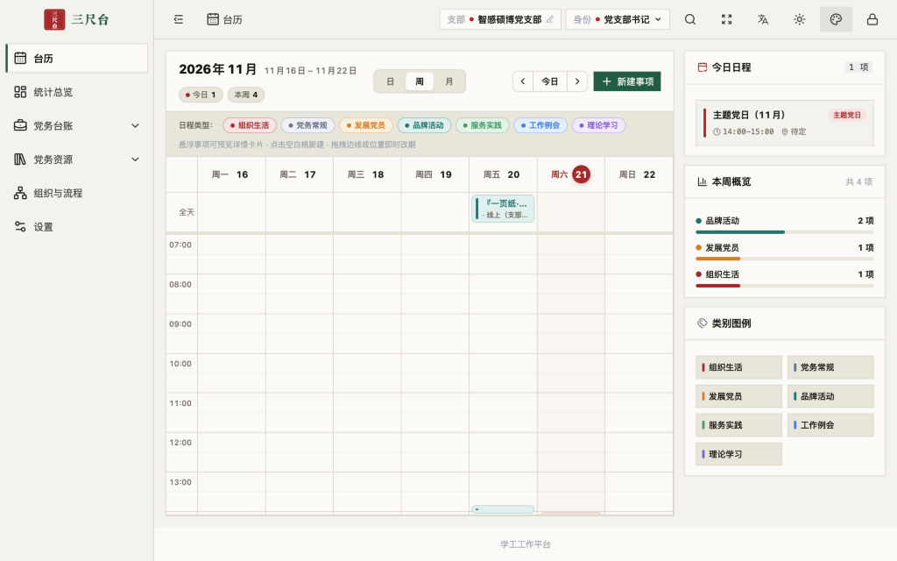
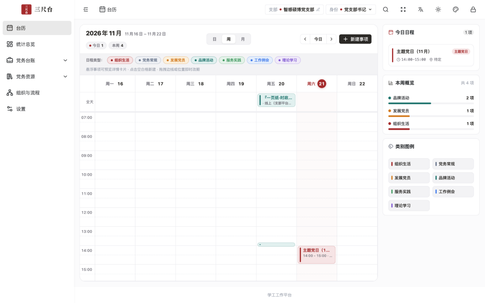
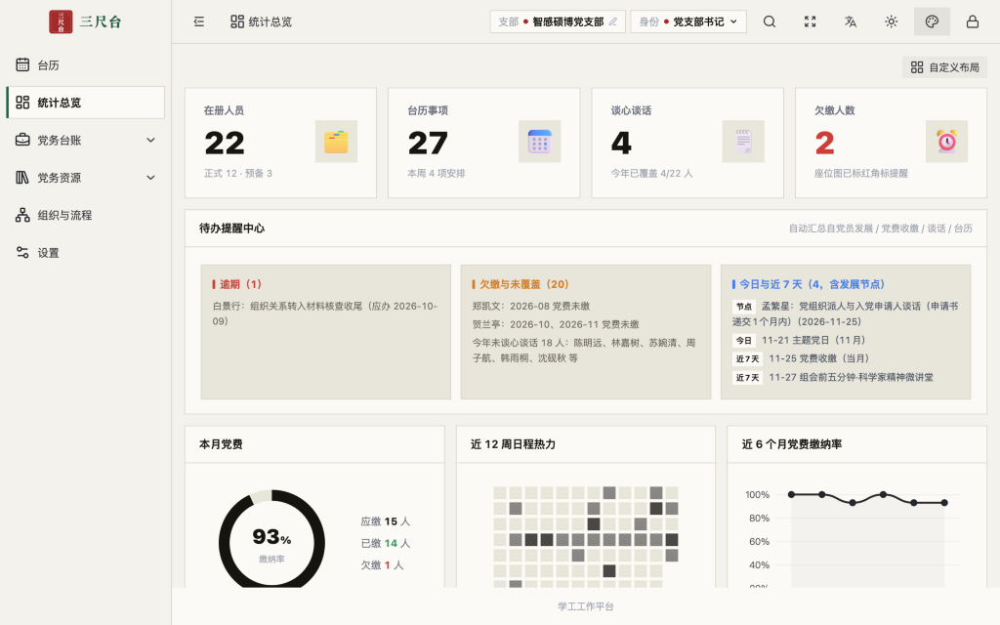
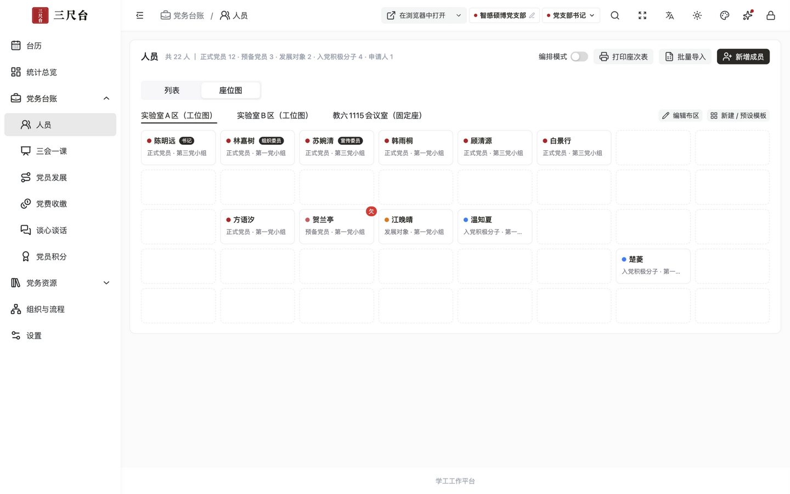
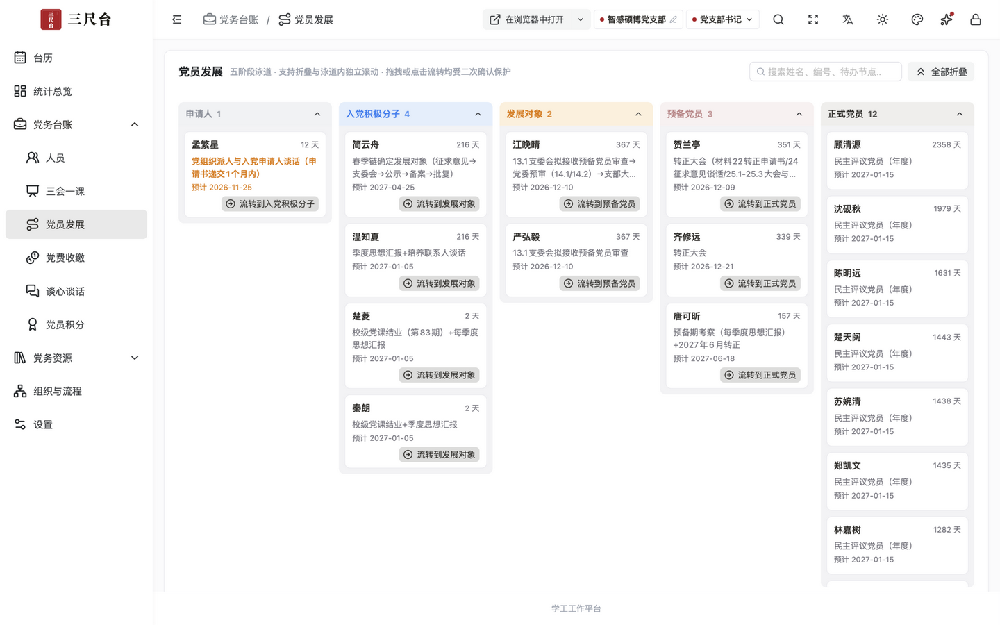
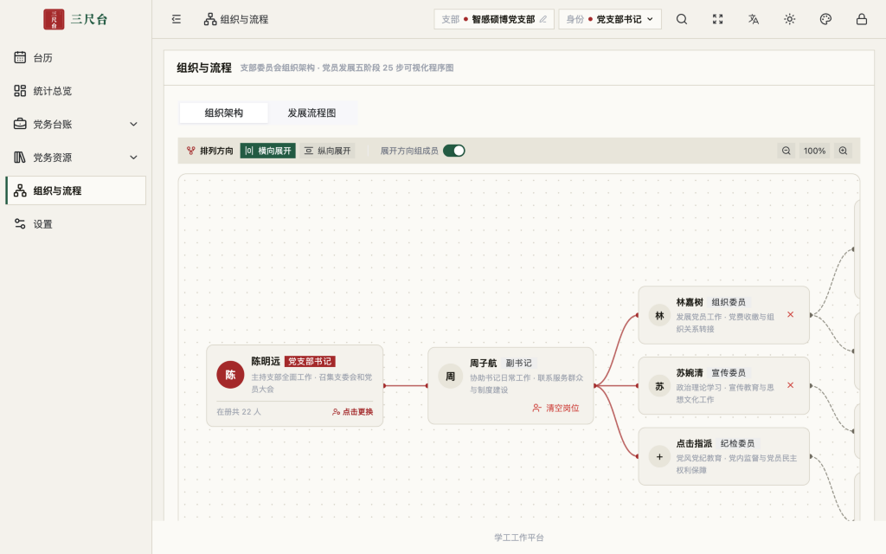

<div align="center">
  
  <h1>三尺台 · SanChiTai</h1>
  <p><strong>面向高校学工与党支部书记的纯本地、离线优先个人工作台</strong></p>
  <p><em>「三尺」取自三尺讲台、三尺案头——给兼任学生工作的你，一方干净、趁手、不联网的案头。</em></p>

  <p>
    
    
    
    
    
    
  </p>

  <p>
    <a href="#-界面预览">界面预览</a> •
    <a href="#-核心功能">核心功能</a> •
    <a href="#-隐私与离线保障">隐私与离线</a> •
    <a href="#-快速开始">快速开始</a> •
    <a href="#-桌面端构建">桌面端构建</a> •
    <a href="#-开源许可协议">许可协议</a>
  </p>
</div>

---

## ✨ 项目简介

**三尺台（SanChiTai）** 是一款专为高校学生工作骨干（党支部书记、班长、团支书、社团负责人、辅导员等）打造的**纯本地、离线优先**个人效率工作台。当前 `v0.2.5` 深度聚焦**「党支部书记」**全周期工作流，以「台历」为核心主视图，将**三会一课、人员花名册与批量导入、座位图预设、25 步党员发展台账、党费收缴矩阵、党员积分台账、谈心谈话、党务材料与政策库、组织架构图、政治生日贺卡**收拢在一张干净的桌面上。

- **零服务器 / 零账号 / 零上报**：所有数据均存储在本地 IndexedDB（Dexie），断网即可完整使用，一键导出 JSON 备份与环形快照。
- **双视觉主题 + 电子纸美学**：内置「墨韵党建红」与「电子纸（E-Paper / KONTUR）」高对比护眼纸感主题，支持浅色 / 深色模式、全局字体切换与全局字号缩放（持久化保存）。
- **多端形态**：支持浏览器直接运行、PWA 离线安装，以及基于 **Tauri v2** 的 Windows（`.exe` / `.msi`）与 macOS（`.dmg`）原生桌面安装包。

---

## 🖼️ 界面预览

### 1. 台历主视图（电子纸主题 vs 默认墨韵主题）

> 日 / 周 / 月视图切换、点空白格新建、拖拽改期、重复日程渲染期投影、类别色标过滤、今日日程与本周概览。

|                    电子纸主题（E-Paper）                     |                        默认墨韵主题                         |
| :----------------------------------------------------------: | :---------------------------------------------------------: |
|  |  |

### 2. 统计总览与待办提醒中心

> 自动汇总逾期事项、党费欠缴、谈心谈话覆盖缺口与近 7 天发展节点；ECharts 可视化呈现近 26 周（半年）日程热力与近 6 个月缴费率。



### 3. 人员座位图 & 党员发展五阶段台账

> 支持教室/工位拖拽换座、点选互换、欠缴角标预警、表格搜索与分页；党员发展严格对齐 25 步材料编号与窗口期提醒。

|           人员座位图（拖拽换座 / 欠缴角标）           |          党员发展（5 阶段泳道 / 25 步节点）           |
| :---------------------------------------------------: | :---------------------------------------------------: |
|  |  |

### 4. 组织架构树与标准工作流程

> 书记 → 副书记 → 支委 → 党小组/党员层级树形展示（支委职务严格限定仅可选正式党员），配套发展党员标准流程图。



---

## 🧩 核心功能

| 模块                       | 核心能力                                                                                                                                                                                                                |
| -------------------------- | ----------------------------------------------------------------------------------------------------------------------------------------------------------------------------------------------------------------------- |
| **📅 台历工作台**          | FullCalendar 日/周/月视图、点击空白快速新建、拖拽改期与调整时长（二次确认）、重复规则渲染期投影（每周/每月第 N 个星期 X/每月 N 日）、类别色标筛选、「撕纸」删除撤销动效、右侧今日日程与本周进度概览、已完成事项状态联动 |
| **📊 统计总览**            | 4 项核心指标卡（入场滚动动效）、待办提醒中心（逾期 / 欠缴与未覆盖 / 近 7 天发展节点）、本月党费环形图、近 26 周日程热力图、近 6 个月缴费率趋势，支持自定义布局                                                          |
| **🪑 人员与座位图**        | 教室/工位可视化座位图（拖拽换座、点选互换、多区布局、撤销快照）、欠缴党费红点角标、人员详情抽屉（发展阶段/缴费/谈话六维信息）、列表视图支持搜索与分页、一键打印座次表                                                   |
| **📋 三会一课**            | 按《支部工作条例》频次一键生成学期排期（幂等去重）、会议考勤勾选与自动计算到会率、按学年 / 按年度筛选、党课并入党员大会口径校验、一键打印会议签到表                                                                     |
| **🏅 党员积分（Preview）** | 年度加减分登记、待核实审批流、预警筛选，支持 Excel 导出与《支部记录表》打印                                                                                                                                             |
| **🌱 党员发展（25 步）**   | 5 阶段泳道（入党申请人 → 积极分子 → 发展对象 → 预备党员 → 正式党员）、25 节点标准材料清单与编号、窗口期高亮提醒、一键流转阶段、预备期满前 7 天自动生成转正大会候选事项                                                  |
| **💰 党费收缴**            | 一键生成本月应缴名单（学生党员 0.2 元/月标准）、人 × 月矩阵点击即记缴、连续欠缴标红提醒、导出对齐学院报表的逐月矩阵 CSV                                                                                                 |
| **💬 谈心谈话**            | 年度谈话覆盖矩阵、入党申请人 1 个月内谈话硬提醒、三步结构化录入、表格搜索与分页                                                                                                                                         |
| **📚 党务资源库**          | **知识库**（党务实操问答）、**政策文件**（权威法规要点与原文直达 + 卡片弹窗阅读 + 自定义增删改）、**材料库**（6 类公文模板 + 自定义/导入模板、双栏实时预览、归档材料在线编辑复用，导出 `.doc` / `.md`）                 |
| **🏛️ 组织与流程**          | 党支部组织架构树（严格限制支委仅可由正式党员担任，支持自定义青年委员）、支部党小组分组（编辑模式拖拽成员重新分组）、发展党员 25 步标准流程图、政治生日贺卡工坊                                                          |
| **🔍 效率与个性化**        | 全局搜索 `⌘K / Ctrl+K`（跨日程、成员、会议、谈话、文件实时检索直达）、中英双语切换、电子纸 / 墨韵双视觉主题、全局字体与字号缩放持久化、本地密码应用锁                                                                   |

---

## 🔒 隐私与离线保障

- **100% 本地存储**：所有业务数据存于浏览器/桌面端本地 IndexedDB（Dexie），**无任何后端服务器、无账号登录、无遥测统计、无数据上报**。
- **备份与防误删**：设置页支持一键导出/导入全量 JSON 备份（导入前自动创建回滚快照），并内置本地 5 份环形自动快照。
- **隐私脱敏设计**：默认不强制采集身份证号与手机号；导出统计报表自动剔除敏感字段；首次启动加载的演示数据为 22 位全化名虚构成员，可在设置页一键清空或重置。

---

## 🚀 快速开始

### 环境要求

- **Node.js** `>= 20.19.0`
- **pnpm** `>= 10.5.0`（仓库锁定 `pnpm@12.10.1`）

### 直接下载安装包（推荐个人使用）

前往 [**Releases**](https://github.com/zzephyrxx/sanchitai/releases) 页面下载最新版本：

- **macOS（Apple Silicon）**：`sanchitai_0.2.5_aarch64.dmg`，拖入「应用程序」即可使用
- **源码包**：`sanchitai-v0.2.5-src.zip`（自行编译请参考下方「本地开发」与「桌面端构建」）

> 💡 也可以直接在浏览器中使用：部署 `pnpm build` 产物至任意静态服务器，即得离线 PWA。

### 本地开发与 Web 预览

```bash
# 1. 克隆仓库
git clone https://github.com/<your-username>/sanchitai.git
cd sanchitai

# 2. 安装依赖
pnpm install

# 3. 启动开发服务器（默认 http://localhost:9527）
pnpm dev

# 4. 类型检查 & 生产构建（含 PWA）
pnpm typecheck
pnpm build

# 5. 本地预览生产包
pnpm preview
```

---

## 💻 桌面端构建（Windows / macOS）

本项目已完整集成 **Tauri v2** 配置（`src-tauri/`），可直接打包为原生桌面应用：

```bash
# 桌面端开发联调
pnpm tauri dev

# 构建当前平台安装包（macOS → .dmg / Windows → NSIS .exe & .msi）
pnpm tauri build
```

> 📘 **Windows 机器完整编译构建教程**（含 Node / pnpm / Rust / VS C++ Build Tools / WebView2 环境准备与常见问题排查）：请阅读 [**docs/WINDOWS_BUILD.md**](./docs/WINDOWS_BUILD.md)。

---

## 🛠️ 技术栈与项目结构

- **前端框架**：Vue 3.5 + TypeScript + Vite (`vite-plus`) + Pinia 4 + Vue Router 5 (Hash 路由)
- **界面与样式**：Naive UI 2.45 + UnoCSS + 自研电子纸（E-Paper）主题变量系统
- **核心引擎**：FullCalendar v6（台历）+ Dexie 4（本地数据库与 `liveQuery`）+ ECharts 6（统计图表）+ `vue-draggable-plus`（拖拽换座）
- **桌面封装**：Tauri v2（Rust）

```text
sanchitai/
├── src/
│   ├── db/            # Dexie v4 数据库 Schema、迁移与演示种子数据
│   ├── views/         # 台历 / 统计总览 / 人员 / 三会一课 / 党员发展 / 党费 / 谈话 / 资源库 / 组织 / 设置
│   ├── layouts/       # 导航栏、全局搜索 (⌘K)、主题抽屉、应用锁门禁
│   ├── styles/        # 墨韵与电子纸主题全局样式与 CSS 变量
│   └── hooks/         # 双语适配 (sct-i18n)、台历投影、打印套件
├── src-tauri/         # Tauri v2 桌面端配置、Rust 入口与全平台应用图标
├── docs/              # 设计规划、Windows 构建指南、代码审查报告与界面截图
└── packages/          # Monorepo 工具包（基于 soybean-admin 底座）
```

---

## 📜 开源许可协议

> ⚠️ **严格非商业个人使用协议（Non-Commercial Personal Use Only）**

本项目代码采用 **[SanChiTai Personal & Non-Commercial Source-Available License v1.0](./LICENSE)** 发布：

- ✅ **允许**：个人学习、科研教学、以及高校个人/基层学生工作的**非商业自用**（允许下载、本地编译运行及个人定制修改）。
- ❌ **严格禁止**：未经著作权人书面授权，严禁用于任何**商业用途**、**二次打包售卖**、**收费代部署/培训**、**企业内部商用**或**对外提供 SaaS / 云端托管服务**；严禁删除或篡改版权声明与许可协议。
- 📦 **第三方组件声明**：本项目所依赖的第三方开源框架与组件（含 `soybean-admin` 等）保留其原有开源协议，详见 [THIRD_PARTY_NOTICES.md](./THIRD_PARTY_NOTICES.md)。

---

## 🙏 致谢

- [soybean-admin](https://github.com/soybeanjs/soybean-admin)（MIT）—— 工程底座与 Monorepo 脚手架
- [super-productivity](https://github.com/johannesjo/super-productivity)（MIT）—— 本地优先环形快照与重复日程投影架构灵感
- [classroom-workbench](https://github.com/chan1988lee/classroom-workbench) —— 座位图交互模式灵感（交互规格为原创 Vue 3 独立实现，未复制其源码）
